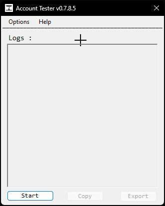

# AccountTester  

    
  
## Description
AccountTester is a Windows Forms application for checking network access and selected user account capabilities on Windows.

## Features
- **Internet:** Sends an HTTP GET request to a configurable URL.
- **Network drives:** Attempts to create and delete a temporary file on each mapped network drive. You can also configure expected drive letters; missing drives are reported.
- **Microsoft Office:** Reads Office version and installation details from the Windows registry. If Office is detected, it uses Microsoft Word to create, edit, save, read, and delete a temporary document.
- **Printers:** Checks installed printers and any additional printer names configured in the options. It checks reachability over TCP port 9100 or ping, and reports when a printer configuration is present.
- **Reports:** Export results as `.txt`, `.json`, `.log`, `.csv`, or `.xml`; `.zip` contains reports in all of these formats.
- **Settings:** Select which test groups to run, choose English or French, configure the HTTP target and timeout, and set expected network drives and additional printer names. Settings can be saved, and reports can be exported automatically after tests.
- **Autorun:** Optionally run tests and export a report when a user logs in to Windows. Enabling this setting requires administrator privileges.

## Prerequisites
- Windows and the .NET 8 Desktop Runtime.
- Microsoft Word installed to run the Office document permissions test. Other tests can run without Word.

## Usage
1. Launch AccountTester and choose the test groups from the **Options** menu.
2. Configure the target URL, timeout, expected drives, or additional printer names if needed, then save your settings.
3. Select **Start** and review the results in the log.
4. Select **Export** to choose a filename, destination, and format. Reports are saved to the Desktop by default. You can enable **Auto-Export** to save a report automatically after each run.

## Issues and Suggestions
If you encounter issues or have suggestions to improve the project, please use the [GitHub issue tracker](https://github.com/Miiraak/Account-Tester/issues).

## License
This project is not licensed. All rights reserved.

## Authors
- [**Miiraak**](https://github.com/miiraak) - *Lead Developer*

---
